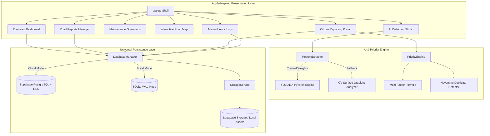

# SmartRoad AI — Architectural Blueprint

## Priority Engine Equation
$$\text{Priority} = (0.40 \times \text{Severity}) + (0.30 \times \text{Traffic}) + (0.20 \times \text{Repeat Reports}) + (0.10 \times \text{Safety Risk})$$

### Threshold Classification
- **75.0 – 100.0:** Critical Priority
- **40.0 – 74.9:** Medium Priority
- **0.0 – 39.9:** Low Priority

### Spatial Duplicate Detection (Haversine)
$$a = \sin^2\left(\frac{\Delta \phi}{2}\right) + \cos(\phi_1)\cos(\phi_2)\sin^2\left(\frac{\Delta \lambda}{2}\right)$$
$$d = 2 R \cdot \text{atan2}(\sqrt{a}, \sqrt{1 - a})$$
Active hazards with distance $d \le 50\text{ meters}$ trigger duplicate suggestion alerts and increment citizen recurrence count.
